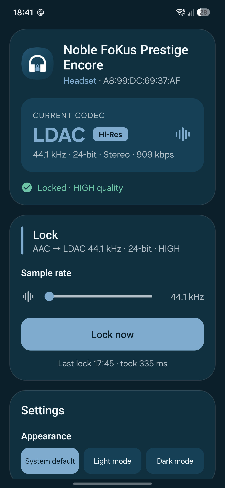

<!-- 1.1 - Copyright (C) 2026 Stouthart. All rights reserved. -->

# Lock Bluetooth LDAC at its highest quality

A small Android app that sets a headphone's **LDAC** connection to its highest quality with one tap, from a Quick Settings tile or the app itself. Android starts every LDAC connection at adaptive quality, which lowers the bitrate whenever the connection gets busy, and on Samsung phones a plain change of the quality setting doesn't even reach the encoder. LDAC Lock makes the change stick, then checks what the encoder actually runs. No internet access, no ads, no account, no background service, and nothing beyond Android itself: the app is 75 KB.

<p align="center"></p>

This is **version 1.1**. The [release notes](RELEASE.md) list what each version changed.

## What it sets

| Phone                   | LDAC encoder                      | LDAC Lock sets                     | Why that rate                                                                                   |
| ----------------------- | --------------------------------- | ---------------------------------- | ----------------------------------------------------------------------------------------------- |
| Samsung Galaxy (One UI) | In the Bluetooth stack (software) | 44.1 kHz, 24-bit, HIGH (909 kbps)  | The mixer follows the codec, so music at 44.1 kHz, such as Spotify, isn't resampled at all     |
| RedMagic                | In the audio chip (hardware)      | 48 kHz, 24-bit, HIGH (990 kbps)    | The mixer runs at a fixed 48 kHz, so LDAC at 48 kHz avoids a second resample back to 44.1 kHz  |

HIGH is LDAC's top quality, known as 990 kbps: it runs at 990 kbps at 48 and 96 kHz, and at 909 kbps at 44.1 and 88.2 kHz.

These are the defaults. **Sample rate** in the Lock section sets 44.1, 48, 88.2 or 96 kHz instead, for the app and the tile alike; a rate the headphone doesn't offer falls back to 44.1 or 48 kHz. Mind the mixer: on Samsung it follows the codec, so above 44.1 kHz the phone resamples 44.1 kHz music; RedMagic's stays at 48 kHz, so any other rate adds a resample in the audio chip.

## Requirements

- **Android 14** or newer
- A headphone with **LDAC**
- **adb** on a computer, to grant one permission (recommended, see [Installation](#installation))
- To build it yourself: **JDK 21** and the **Android SDK** command-line tools with `platforms;android-37.0` and `build-tools;37.0.0`. The project brings its own Gradle.

Developed and tested on a **Samsung Galaxy S25 Edge** (One UI 9, Android 17) and a **RedMagic Astra** (REDMAGIC OS 11, Android 16), with Noble FoKus Prestige Encore and FoKus Amadeus headphones. Other Samsung and RedMagic devices should work alike. On other phones LDAC Lock detects which kind of encoder they have and picks the matching method, but that is untested. So are Android 14 and 15: the method was worked out on Android 16 and 17, and an older Bluetooth stack may behave or report differently.

## Installation

Download `LDAC-Lock-1.1.apk` from the [latest release] and open it on the phone; Android asks to allow installing apps from that source first. Or install it from a computer with the phone connected over USB or wireless debugging:

```bash
adb install LDAC-Lock-1.1.apk
```

Then grant the one permission an app can't ask for itself:

```bash
adb shell pm grant nl.stouthart.ldaclock android.permission.DUMP
```

`DUMP` lets LDAC Lock read the encoder's real state and tell a software encoder from a hardware one; [Permissions](#permissions) says why that matters.

### Building it yourself

```bash
git clone https://github.com/Stouthart/LDAC-Lock.git
cd LDAC-Lock
echo "sdk.dir=$ANDROID_HOME" >local.properties   # the SDK's location
./gradlew assembleRelease
adb install app/build.nosync/outputs/apk/release/app-release.apk
```

Your build is signed with your own debug key, the release APK with mine. Android won't update one with the other, so uninstall the downloaded app before installing your own build, and grant `DUMP` again afterwards.

[latest release]: https://github.com/Stouthart/LDAC-Lock/releases/latest

## Setup

1. Open **LDAC Lock** and allow **Nearby devices**.
2. With the headphone connected, tap **Pair headphone** and confirm the system dialog. Android lets an app change a headphone's codec only after this companion-device pairing; repeat it for each headphone.
3. Add the **LDAC Lock** tile: pull down Quick Settings, tap the pencil, and drag it into the panel.

## Usage

Tap the tile, or **Lock now** in the app. LDAC Lock works on the headphone Android is playing to; with two connected, the other one is left alone.

- **Samsung (software encoder):** it switches to AAC and back to LDAC, at 44.1 kHz or the chosen **Sample rate**, with 32-bit and then 24-bit, each at the top quality. The detour makes the phone reopen the stream, which a plain LDAC change doesn't do on Samsung, and the 32 → 24-bit step makes the stack pass the quality on. Music pauses for about a second and a half. Samsung resets LDAC on every connection, so tap once per connection.
- **RedMagic (hardware encoder):** one LDAC change to 48 kHz or the chosen **Sample rate**, 24-bit, top quality, and only with playback paused: a change while music plays leaves the audio chip silent, sometimes until the headphone reconnects. While music plays, a tap only shows **Pause first**. The setting stays across reconnects.

The screen shows the headphone, the current codec and whether it is locked, and follows the headphone and Bluetooth as they change.

### The tile

| Tile                        | Samsung (second line)          | RedMagic (name) |
| --------------------------- | ------------------------------ | --------------- |
| Highlighted                 | The bitrate, such as `909 kbps` | `LDAC Locked`   |
| Normal                      | `Not locked` or `Failed`       | `LDAC Lock`     |
| While it runs               | `Locking…`                     | `Locking…`      |
| Tap refused during playback | `Pause playback first` *       | `Pause first`   |
| Greyed out                  | `Bluetooth off`                | `Bluetooth off` |

\* On Samsung only without the `DUMP` permission.

RedMagic's round tiles don't show a second line, so there the tile's name carries the status. When you open Quick Settings, a tile that claims a lock checks the codec again, and turns normal after a reconnect.

### The screen

| Status line                                    | Meaning                                                                                                          |
| ---------------------------------------------- | ---------------------------------------------------------------------------------------------------------------- |
| `Locked · HIGH quality`                        | The encoder runs at the top quality, read from the encoder itself                                                |
| `Not locked · <mode> quality`                  | LDAC, but the encoder runs adaptive (ABR) or a lower quality                                                     |
| `Locked · quality not readable on this device` | Rate, bit depth and the reported quality match; RedMagic's audio chip doesn't report what it actually runs     |
| `Not locked`                                   | Another codec, rate or bit depth                                                                                 |

Above **Lock now**, **Sample rate** sets the rate the next lock aims at; moving it never locks by itself. Below, the last lock shows its time and how long it took, or why it failed.

Under **Settings**, **Appearance** sets the app's look: **System default** follows the phone, **Light mode** and **Dark mode** set it for LDAC Lock alone.

## Permissions

| Permission                             | Why                                                                                                                                                                                                                                                  |
| -------------------------------------- | ---------------------------------------------------------------------------------------------------------------------------------------------------------------------------------------------------------------------------------------------------- |
| Nearby devices (`BLUETOOTH_CONNECT`)   | Reading and changing the codec                                                                                                                                                                                                                       |
| Companion device pairing               | Android lets an app change a headphone's codec only after you pair the app with it                                                                                                                                                                   |
| Foreground service (`connectedDevice`) | Keeps a lock running when the Quick Settings panel closes. It shows no notification, as the app doesn't ask to show one.                                                                                                                             |
| Starting from the background as a companion app | Lets the tile start that service                                                                                                                                                                                                             |
| `DUMP`, granted over adb               | Reads the encoder's real state from `dumpsys bluetooth_manager`, and detects a hardware encoder and the mixer's rate. Without it, LDAC Lock can't verify the quality or tell which encoder the phone has, so to be safe it changes nothing during playback. |

No internet permission: nothing can leave the phone.

## Notes

- The codec calls are hidden Android APIs, reached by reflection: `getCodecStatus`, `setCodecConfigPreference` and `getActiveDevice`. They may change with an Android update.
- LDAC Lock detects the phone's encoder once per firmware build, and again after a system update.
- An app that sets codecs automatically, such as a codec switcher with an auto-switch, can undo a lock. Turn that off.
- Nothing runs in the background: LDAC Lock only works when you tap, and listens to Bluetooth only while its screen or Quick Settings is open. It starts in about 140 ms.
- Build output goes to `build.nosync` folders, which iCloud Drive doesn't sync.

### Device quirks

- **Samsung** lets the headphone set up each connection, and then ignores LDAC changes that keep the codec: hence the detour via AAC. Its reported quality setting can say 990 while the encoder runs adaptive, so LDAC Lock reads the encoder itself.
- **RedMagic** encodes LDAC in its Qualcomm audio chip, whose driver can't reconfigure a stream while it plays. Its mixer is fixed at 48 kHz, so music at 44.1 kHz is always resampled once. RedMagic's DTS sound processing also runs in the audio path: turn **DTS Sound** off in Settings › Sound for an unaltered signal.

## Credits

The icons are Google's Material Icons `headphones`, `check_circle` and `error`, under the Apache License 2.0.

## License

Copyright (C) 2026 Stouthart. All rights reserved.

_The source code in this repository is free for personal use. However, it is NOT published under a software license. This implies - as stated in the [GitHub Docs] - that standard copyright law applies, meaning the owner retains all rights to the source code and no one may reproduce, distribute, or create derivative works from this work._

[GitHub Docs]: https://docs.github.com/en/repositories/managing-your-repositorys-settings-and-features/customizing-your-repository/licensing-a-repository
